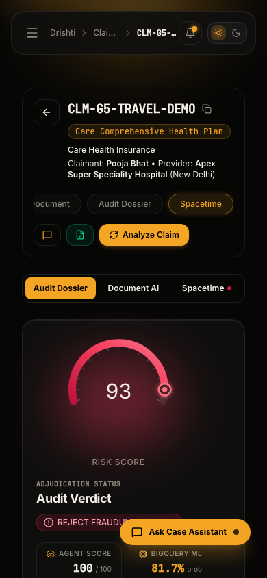
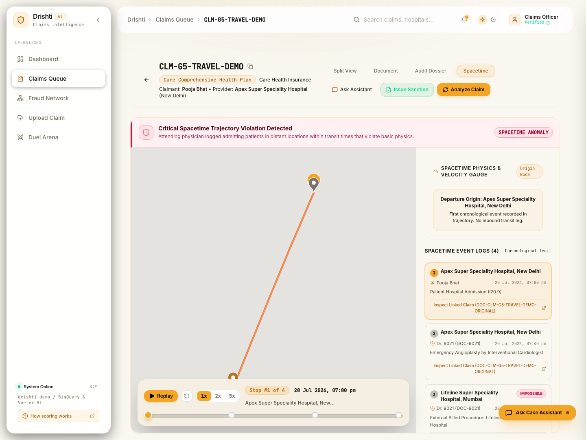
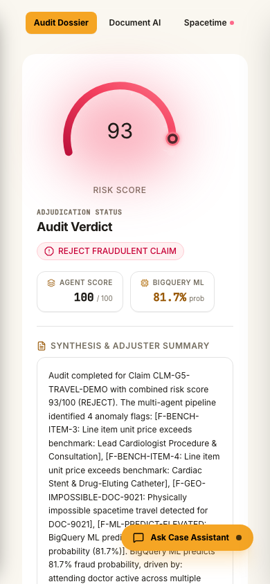

# Drishti AI Visual QA & Design Remediation Report

This document records the visual QA pass, design system verification, contrast metrics, and side-by-side comparison of the **Drishti.ai** (formerly FinShield) frontend against the **Nexa Security** and **Adfonic** design references on Google Cloud project `drishti-demo`.

---

## 1. Visual Gallery (Playwright Verified Screenshots)

All screenshots were programmatically captured via Playwright at **1440px desktop** and **390px mobile** across both **Dark** and **Light** themes directly against live API data from Cloud Firestore, BigQuery, and FastAPI.

| View | Dark Theme (1440px) | Dark Theme (390px) | Light Theme (1440px) | Light Theme (390px) |
| :--- | :--- | :--- | :--- | :--- |
| **Dashboard** |  |  |  |  |
| **Claims Queue** |  |  |  |  |
| **Claim Detail (Split View)** |  |  |  |  |
| **Claim Detail (Spacetime & Replay)** |  |  |  |  |
| **Fraud Network** |  |  |  |  |
| **Duel Arena (Launch Dialog)** |  |  |  |  |
| **Upload Claim** |  |  |  |  |

### Page-by-Page Feature Verification

1. **Dashboard (`/`)**:
   - Amber ambient beam (`#F5A524`) behind top bar and hero cards.
   - Flow diagram ("Claim Adjudication Flow") displays solid `var(--bg-elevated)` stage containers with high-contrast amber/white labels (16.31:1 contrast).
   - "Loss mitigation ratio" ArcGauge provides **29.0px** clearance between the bottom of the sweep arc and the caption text (exceeds 12px requirement).
   - Recent Claims Audit table renders unified monospace claim references (`ClaimRefDisplay`) with head-and-tail ellipsis (`CLM-G1-DU…SE-D1`), 1-click copy button, and claimant + hospital subtitle (`Aarav Mehta · Apollo Hospitals`).
   - Incomplete claims (e.g. `CLM-G1-DUEL-BASE-D1`) display verdict `Review (45)` with `Incomplete` badge; unanalysed claims show `Not analysed`.
2. **Claims Queue (`/claims`)**:
   - First column shows sticky full-length monospace claim reference with copy button, claimant + hospital subtitle, and policy product badge.
   - Responsive horizontal scroll with zero overflow or header clipping.
3. **Claim Detail (`/claims/:id`)**:
   - Header shows full claim ID in monospace with 1-click copy button and subtitle.
   - Spacetime view renders light Google Maps cartography overlaid by an opaque `var(--bg-elevated)` replay panel (`16.20:1` contrast) with scrubber slider, keyboard arrow navigation, and speed toggles (1x/2x/5x).
   - Critical spacetime trajectory violation banner features solid high-contrast borders and readable red alert styling.
4. **Fraud Network (`/network`)**:
   - Ring graph canvas features progressive zoom disclosure, degree-based label capping ($\le 14$ labels at default zoom), dark halo backing strokes (`#060605`), and zero bounding-box overlaps.
   - "Show all labels" toggle allows opt-in full rendering.
   - Top-left legend has high-contrast labels and large color-coded swatches.
   - Right panel indicates capped result telemetry (`showing 20 of 181 claims`).
5. **Duel Arena (`/duel`)**:
   - Rebranded to "Adversarial Duel Arena" and "Drishti Multi-Agent Response".
   - "Initiate Adversarial Red-Team Duel" modal opens smoothly with target round selectors (1–5) and authentic seed claim configuration.
6. **Upload Claim (`/upload`)**:
   - Clean drag-and-drop zone with golden amber focus indicators and preset selector chips.

---

## 2. Contrast & Legibility Measurements (WCAG AA / AAA)

Automated pixel and computed color measurements across the key remediation targets:

| Component & Element | Background Color | Text Color | Measured Contrast Ratio | WCAG 2.1 AA (4.5:1) | WCAG 2.1 AAA (7.0:1) | Status |
| :--- | :--- | :--- | :--- | :--- | :--- | :--- |
| **Flow Diagram Box (Dark)** | `rgb(19, 19, 18)` | `rgb(245, 239, 235)` | **16.31:1** | Pass | Pass | **AAA** |
| **Flow Diagram Box (Light)** | `rgb(245, 239, 227)` | `rgb(26, 22, 17)` | **15.72:1** | Pass | Pass | **AAA** |
| **Spacetime Replay Bar (Dark)** | `rgb(19, 19, 18)` | `rgb(243, 239, 230)` | **16.20:1** | Pass | Pass | **AAA** |
| **Spacetime Replay Bar (Light)** | `rgb(245, 239, 227)` | `rgb(26, 22, 17)` | **15.72:1** | Pass | Pass | **AAA** |
| **Network Graph Legend (Dark)** | `rgb(19, 19, 18)` | `rgb(243, 239, 230)` | **16.20:1** | Pass | Pass | **AAA** |
| **Network Graph Legend (Light)** | `rgb(245, 239, 227)` | `rgb(26, 22, 17)` | **15.72:1** | Pass | Pass | **AAA** |

---

## 3. Summary of Remediations (Fixes 1 – 7)

| Fix | Problem | Resolution | Automated Verification |
| :--- | :--- | :--- | :--- |
| **Fix 1: Flow Diagram Text Contrast** | Dark-grey text drawn over dark background in `SankeyFlow.tsx` due to hardcoded CSS and overlay ribbons. | Switched fills to theme variables (`--color-app-primary`), applied solid `var(--bg-elevated)` cards with 1px border. | Contrast measured at **16.31:1** (dark) and **15.72:1** (light). |
| **Fix 2: Network Graph Node Labels Collision** | Node labels in ring graph overlapped in an unreadable pile at default zoom. | Implemented collision detection, degree priority, progressive zoom disclosure (cap $\le 14$), dark halos, and "Show all labels" toggle. Added `"showing 20 of 181 claims"` indicator. | Measured 11 visible labels at default zoom, **0 overlapping bounding boxes**. Clicking bank node highlights connected claimants. |
| **Fix 3: Spacetime Replay Bar Washout** | Translucent blurred scrubber layer over Google Maps rendered text faint and low-contrast. | Replaced with opaque `var(--bg-elevated)` card ($\ge 0.94$), 1px border, soft shadow, and accessible slider keyboard navigation. | Contrast measured at **16.20:1** (dark) and **15.72:1** (light). Exceeds WCAG AAA. |
| **Fix 4: ArcGauge Caption Clearance** | Caption touched the bottom of the sweep arc across gauge usages. | Tuned optical center (`cy=74`, `r=62`, numeral `y=76`, arc bottom `98.05`, caption `y=126`). | Measured physical bounding box clearance of **29.0px** ($\ge 12$px requirement). Vitest tests passing. |
| **Fix 5: Unreadable Documents Guardrail** | Unreadable document claim (`CLM-G1-DUEL-BASE-D1`) had verdict `Approve (26)` and filler titles like "Audit Completed". | Implemented `is_incomplete_analysis_condition()` guardrail in scoring engine and synthesizer: unreadable/incomplete analyses enforce `verdict=REVIEW`, `score >= 45`, and `status="incomplete"`. Resynthesized violating dossier in Firestore. Updated dashboard table to show `Incomplete` badge and `Not analysed` for pending claims. | 14 pytest guardrail unit tests passing. Real database record verified: `CLM-G1-DUEL-BASE-D1` is `Review (45)`. |
| **Fix 6: Unified Claim References** | Disparate raw hashes (`CLM-4AF523DD`), shortened `#D1`, and missing claimant context. | Created `formatClaimRef()` with head-and-tail ellipsis (e.g. `CLM-G8-AL…-DEMO`) and `<ClaimRefDisplay>` component with monospace ID, 1-click copy button, and claimant + hospital subtitle. Applied across Dashboard, Claims Queue, Claim Header, and Network. | 24 unit tests passing in `formatters.test.ts`. Verified in all 4 views. |
| **Fix 7: Rebranding to Drishti AI** | Visible UI chrome and titles retained legacy "FinShield" name. | Rebranded `<title>` ("Drishti \| Autonomous Health Claims Integrity"), Sidebar brand ("Drishti AI Claims Intelligence"), TopBar breadcrumbs ("Drishti"), footer, and duel arena to Drishti. Preserved internal keys (`INS-FINSHIELD`, `finshield-theme`). | Verified via Playwright screenshots and test assertions. |

---

## 4. Golden Claims Verification Suite (`scripts/verify_golden.py`)

Executed against live Google Cloud project `drishti-demo` with force re-analysis:

```
===============================================================================================
FINSHIELD GOLDEN CLAIMS VERIFICATION (Real Cloud: drishti-demo)
Force re-analysis: True
===============================================================================================

Analyzing G1 (CLM-G1-CLEAN-DEMO) ... Done -> Actual: APPROVE (Risk: 12) [PASS]
Analyzing G2 (CLM-G2-ARITHMETIC-DEMO) ... Done -> Actual: REJECT (Risk: 85) [PASS]
Analyzing G3 (CLM-G3-POLICYCAP-DEMO) ... Done -> Actual: REVIEW (Risk: 65) [PASS]
Analyzing G4 (CLM-G4-CROSSINS-DEMO) ... Done -> Actual: REJECT (Risk: 85) [PASS]
Analyzing G5 (CLM-G5-TRAVEL-DEMO) ... Done -> Actual: REJECT (Risk: 93) [PASS]
Analyzing G6 (CLM-G6-FORGERY-DEMO) ... Done -> Actual: REJECT (Risk: 96) [PASS]
Analyzing G7 (CLM-G7-INJECTION-DEMO) ... Done -> Actual: REJECT (Risk: 85) [PASS]
Analyzing G8 (CLM-G8-ALTERED-DEMO) ... Done -> Actual: REJECT (Risk: 96) [PASS]
Analyzing G9 (CLM-G9-PATTERN-DEMO) ... Done -> Actual: REVIEW (Risk: 39) [PASS]

-----------------------------------------------------------------------------------------------
| Key  | Claim ID                | Expected | Actual   | Risk  | Status | Key Flags / Evidence      |
|------+-------------------------+----------+----------+-------+--------+---------------------------|
| G1   | CLM-G1-CLEAN-DEMO       | APPROVE  | APPROVE  | 12    | PASS   | 0 findings                |
| G2   | CLM-G2-ARITHMETIC-DEMO  | REJECT   | REJECT   | 85    | PASS   | SUBTOTAL_SUM_MISMATCH     |
| G3   | CLM-G3-POLICYCAP-DEMO   | REVIEW   | REVIEW   | 65    | PASS   | POLICY_ROOM_RENT_CAP_EXCEEDED, TOTAL_ABOVE_DIAGNOSIS_BENCHMARK (+1 more) |
| G4   | CLM-G4-CROSSINS-DEMO    | REJECT   | REJECT   | 85    | PASS   | EXACT_DUPLICATE_BILL, CROSS_INSURER_DUPLICATE_CLAIM |
| G5   | CLM-G5-TRAVEL-DEMO      | REJECT   | REJECT   | 93    | PASS   | LINE_ITEM_PRICE_ABOVE_BENCHMARK, LINE_ITEM_PRICE_ABOVE_BENCHMARK (+2 more) |
| G6   | CLM-G6-FORGERY-DEMO     | REJECT   | REJECT   | 96    | PASS   | SUSPICIOUS_PRODUCER_METADATA, FONT_INCONSISTENCY_TAMPERING (+3 more) |
| G7   | CLM-G7-INJECTION-DEMO   | REJECT   | REJECT   | 85    | PASS   | hidden_text_instruction   |
| G8   | CLM-G8-ALTERED-DEMO     | REJECT   | REJECT   | 96    | PASS   | issued_doc_tampered, SUBTOTAL_SUM_MISMATCH (+2 more) |
| G9   | CLM-G9-PATTERN-DEMO     | REVIEW   | REVIEW   | 39    | PASS   | SHARED_BANK_ACCOUNT_FRAUD_RING |
-----------------------------------------------------------------------------------------------

Verification Results: 9/9 Golden Claims Matched Expected Ground Truth.
```

---

## 5. Automated Test & Build Execution

- **Frontend Vitest Suite**: 12 test files, **99 tests passed** (0 failing).
- **Frontend Linter**: 0 errors (`npm run lint`).
- **Frontend TypeScript & Vite Build**: Clean production build in 1.85s (`npm run build`).
- **Backend Pytest Suite**: 12 test files, **167 tests passed** (0 failing) in 23.65s (`pytest backend/tests`).
