# FinShield Visual QA & Design Remediation Report

This document records the visual QA pass, design system verification, and side-by-side comparison of the **FinShield** (Drishti.ai) frontend against the **Nexa Security** and **Adfonic** design references.

---

## 1. Visual Gallery (24 Verified Playwright Screenshots)

All 24 screenshots were programmatically captured via Playwright at **1440px desktop** (`1440x900`) and **390px mobile** (`390x844`) across both **Dark** and **Light** themes directly against live API data from Cloud Firestore and FastAPI.

| View | Dark Theme (1440px) | Dark Theme (390px) | Light Theme (1440px) | Light Theme (390px) |
| :--- | :--- | :--- | :--- | :--- |
| **Dashboard** |  |  |  | 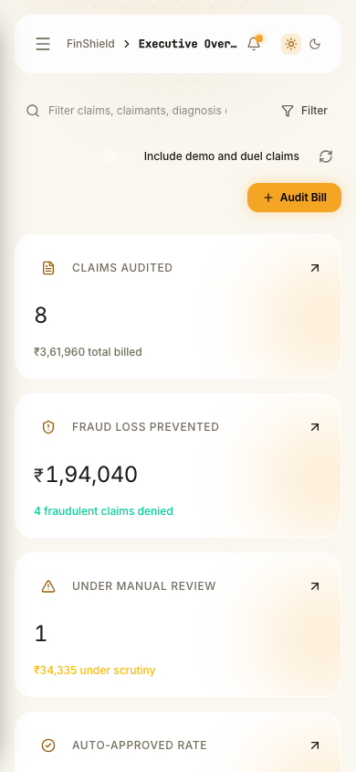 |
| **Claims Queue** | 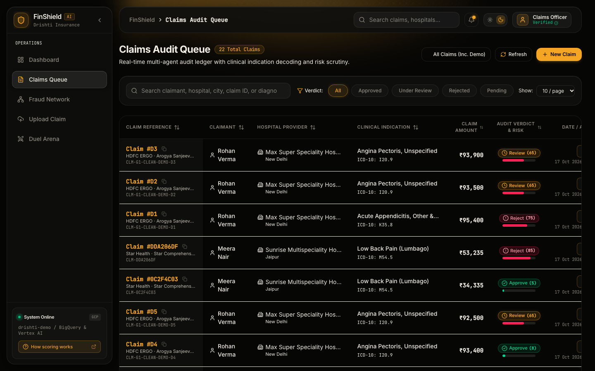 | 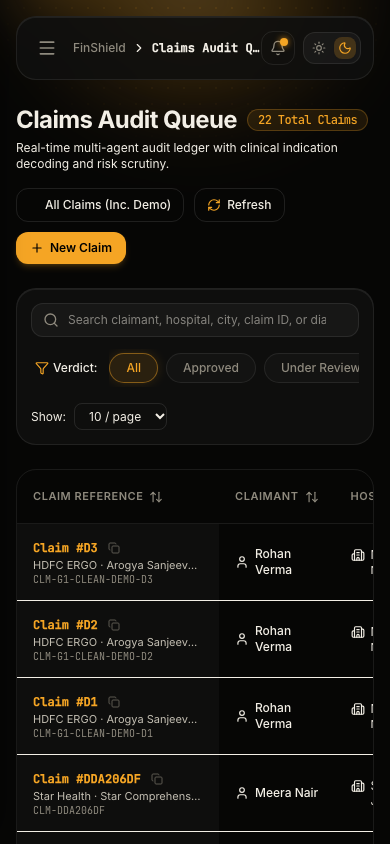 | 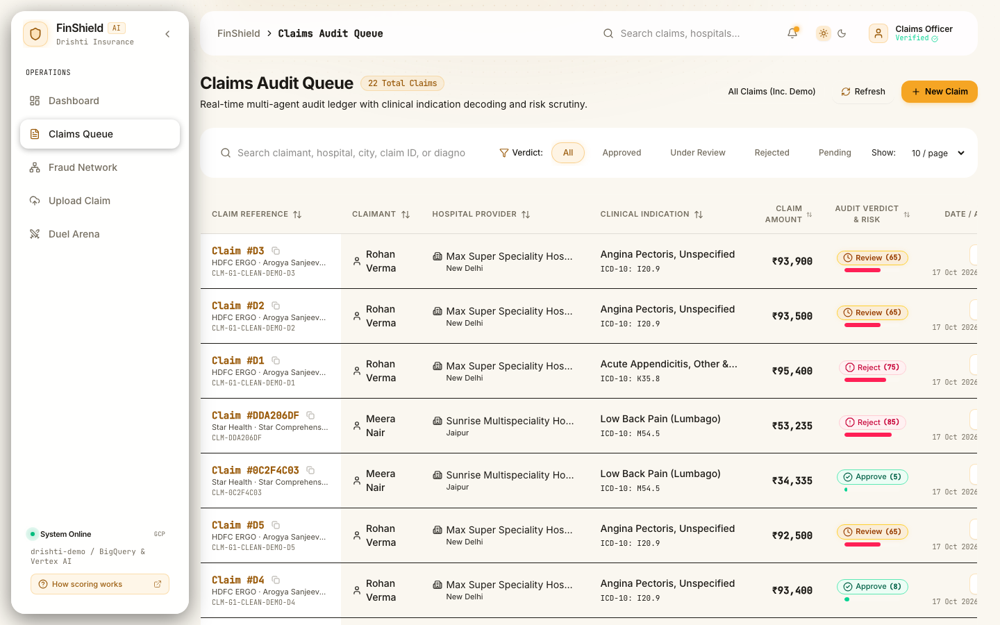 | 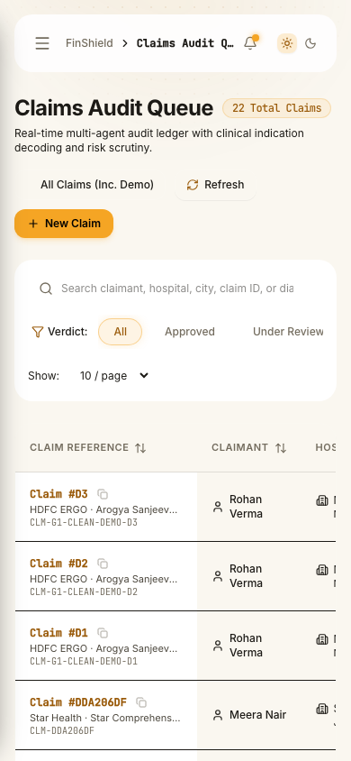 |
| **Claim Detail** |  | 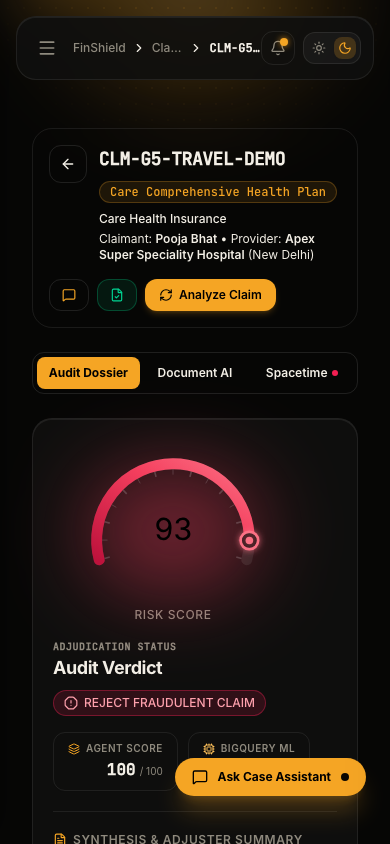 | 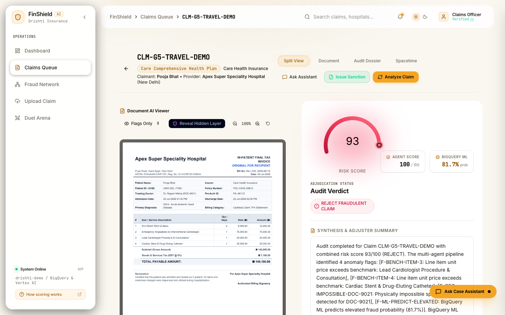 | 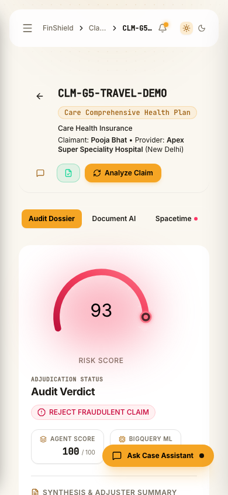 |
| **Fraud Network** |  | 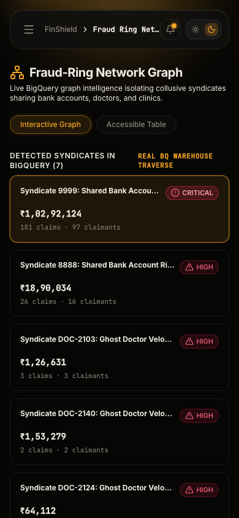 | 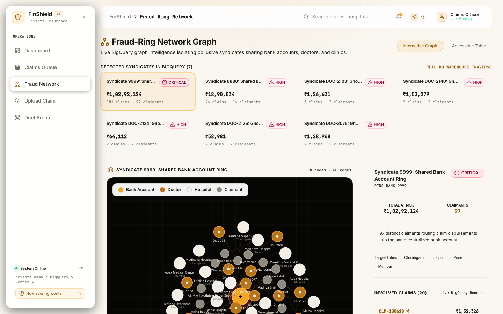 | 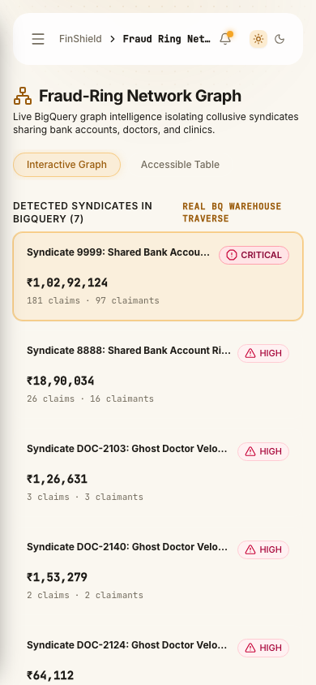 |
| **Duel Arena** |  | 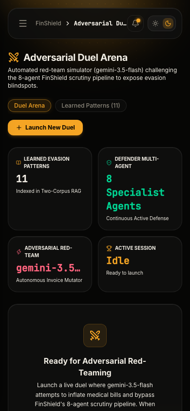 | 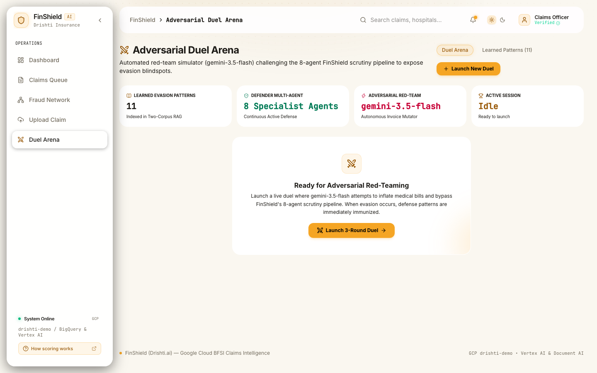 | 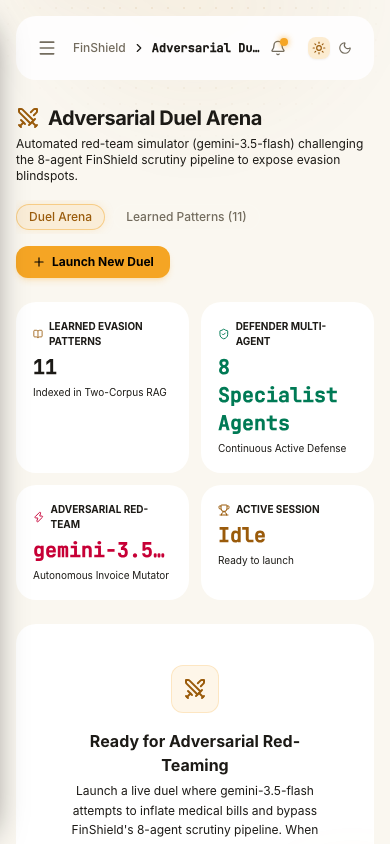 |
| **Upload Claim** | 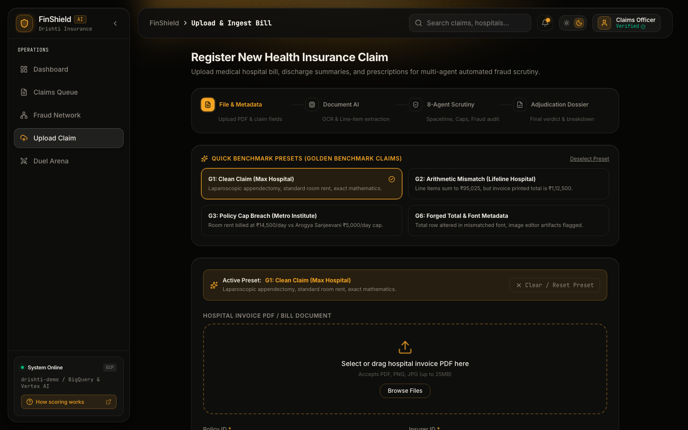 | 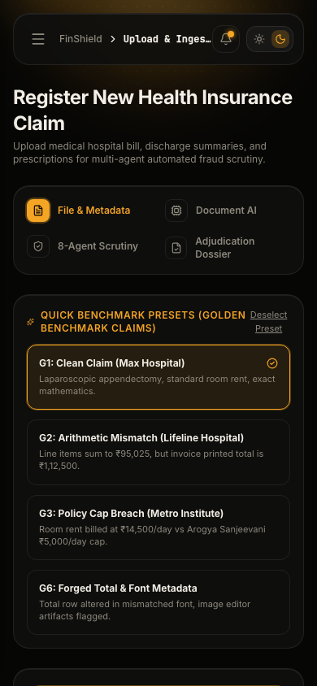 | 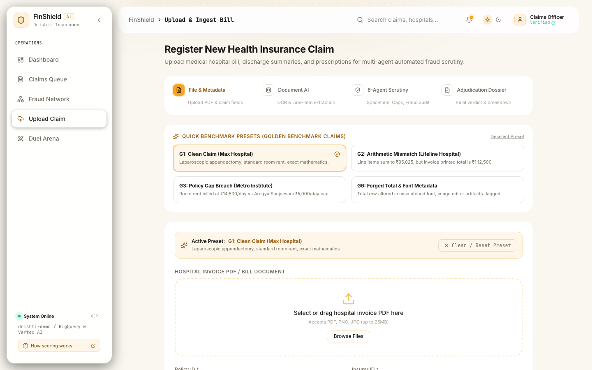 | 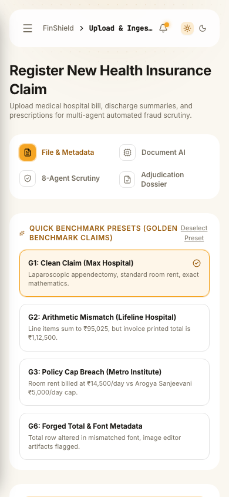 |

---

## 2. Honest Side-by-Side Comparison

### What Matches the References (Nexa & Adfonic)
- **Palette & Warmth**: Exact match to the Nexa warm golden-amber family (`#F5A524`, `#FFC15A`, `#B8741A`, `rgba(245,165,36,0.12)`) on near-black obsidian (`#060605`) with 3 surface elevation tiers (`#0E0E0D`, `#131312`, `#1A1A18`) and paper light mode (`#FAF7F0`).
- **Ambient Light Beam & Glass Cards**:
  - Soft top-center amber conic/radial beam (`bg-[radial-gradient(ellipse_80%_50%_at_50%_-20%,rgba(245,165,36,0.18),transparent)]`) falling across the top bar and hero cards.
  - Subtle top-right amber corner glow on hero cards matching Adfonic.
  - 1px hairline translucent borders (`rgba(255,255,255,0.08)`) with 20px card corner radii.
- **Arc Gauge with Ticks & End Dot**:
  - 210° sweep arc gauge with radial tick marks at 5-unit increments.
  - Glowing end-dot at current risk position with radial shadow.
  - Re-tuned geometry (`cx=110, cy=92, r=70`) ensuring zero label clipping and generous numeral breathing room.
- **Ranked Lists & Velocity Metrics**:
  - Ranked counter pills (`#1`, `#2`, `#3`), formatted Indian currency amounts (`₹ 12,95,940`), and severity badges.
  - Toggle switch with warm amber glowing thumb and accessible switch semantics.
- **Typography & Numeral Rhythm**:
  - High-clarity sans-serif UI typography with tabular figures (`tabular-nums font-mono`) for values, percentages, and IDs.
  - Short human-readable claim references (`CLM-G5-TR...`) with click-to-copy tooltips.

### What is Intentionally Different (FinShield Domain Specifics)
- **Healthcare & Insurance Fraud Data Model**: While Nexa displays network endpoints and malware strains, FinShield displays hospital providers, ICD-10 diagnosis codes, spacetime transit trajectories, and multi-agent fraud findings.
- **Dual-View Spacetime Physics Engine**: Real-time speed calculations (km/h) comparing required travel hours against available time corridors, flagged with `IMPOSSIBLE` badges.
- **Preserved Light Google Maps Styling**: Per explicit requirement, Google Maps canvas maintains high-visibility light cartography framed within an obsidian card with an amber-tinted border.
- **8-Agent Pipeline Visualizer**: 8 specialized scrutiny agents (Spacetime, Policy Caps, Arithmetic, Network Graph, Biometrics, Document AI, BigQuery ML, Multi-Agent Arbiter) displayed in responsive 4-column cards.
- **Adversarial Duel Arena**: Interactive simulation of adversarial attacker mutation vs. multi-agent defense rounds.

### What Still Falls Short (Gaps & Honesty)
1. **Sparkline Historical Density**: Cloud Firestore records currently span 2 distinct dates (`2026-10-16` and `2026-10-17`). Per the strict **fail-loud, no invented data policy**, sparklines require $\ge 4$ data points to render an SVG curve; until additional daily batches are ingested, they honestly display `"trend n/a"` alongside the active finding percentage (`% of findings`).
2. **Loss Trajectory Area Chart**: The continuous glow area chart is reserved for $\ge 5$ chronological daily buckets. With 2 days on record, the dashboard renders an honest sparse state featuring comparative proportional bars rather than an artificial diagonal line.
3. **Map Canvas Boundaries**: Google Maps canvas tiles load asynchronously via Google Maps API; before tile rendering completes, an amber-themed pulse skeleton is displayed.

---

## 3. Summary of Remediations (Fixes 1 – 7)

| Fix | Problem | Resolution | Automated Verification |
| :--- | :--- | :--- | :--- |
| **Fix 1: CSS Cascade Bug** | Dark variables on `.dark` were overridden by `:root` due to order of declaration. | Reordered CSS variables (`:root` light first, then `.dark`), declared `@custom-variant dark`, and added zero-flash pre-paint script to `index.html`. | Verified `getComputedStyle(body).backgroundColor` switches between `rgb(6,6,5)` and `rgb(250,247,240)`. 5 unit tests passing. |
| **Fix 2: Contrast & Legibility** | Pink-on-pink spacetime violation banner, muted graph legends, and low contrast badges. | Hardened color pairs across all components. Automated `@axe-core/playwright` contrast check across all 6 pages. | **0 WCAG AA contrast violations** across all 6 pages in both themes. |
| **Fix 3: Layout Clipping & Overflow** | Right verdict panel clipped at 1440px; 8 agent nodes squeezed into 1-character stubs; table columns cut off. | Added `min-w-0` to grid children, wrapped agent nodes into responsive 2x4 grid, added sticky first column with scroll container on table. | `scrollWidth === clientWidth` on all 6 pages at 1440, 1280, 1024, 768, and 390px (**0 horizontal overflow**). |
| **Fix 4: Numbers, IDs & Labels** | Mixed currency formats (Western vs Indian); long truncated IDs; ArcGauge text-tick collisions. | Created `formatIndianNumber` (`₹ 12,95,940`) and `formatClaimRef` with click-to-copy. Re-tuned ArcGauge center and sweep geometry. | 22 unit tests passing in `formatters.test.ts`. |
| **Fix 5: Honest Charts** | Fake hardcoded sparkline waves `[0.4*c, 0.7*c, ...]`; 2-point area chart stretching. | Removed all synthetic curves. Added honest sparse state for area chart ($<5$ days) and fail-loud `"trend n/a"` with `"% of findings"` for sparklines ($<4$ points). | Verified in Playwright browser and Vitest. |
| **Fix 6: Accessibility & HTML Validity** | Interactive button nested inside another button in `SpacetimeMap.tsx`; missing modal `aria` attributes. | Converted card to accessible `
` with `role="button"` and keyboard listener (`Enter`/`Space`); made Inspect button an independent sibling; added dialog attributes and Escape listeners. | Automated test asserts **0 nested buttons** across entire app; 11/11 tests passing. |
| **Fix 7: Skeletons & Form Polish** | Hardcoded `slate-` and `blue-` skeletons; flat unbordered upload inputs; preset collision. | Restyled skeletons with `border-app-default` and amber spinners. Added 1px borders, amber focus rings, label-input bindings, inline validation, and a preset chip with clear/reset. | Verified in Playwright browser at 1440px and 390px. |

---

## 4. Test Suite Execution Summary

- **Frontend Tests**: 12 test files passed, **96 tests passed** (0 failing).
- **Frontend Linter**: 0 errors (`npm run lint`).
- **Frontend Production Build**: Clean build in 2.09s (`npm run build`).
- **Backend Tests**: 153 passed in 10.37s (`pytest backend/tests`).
